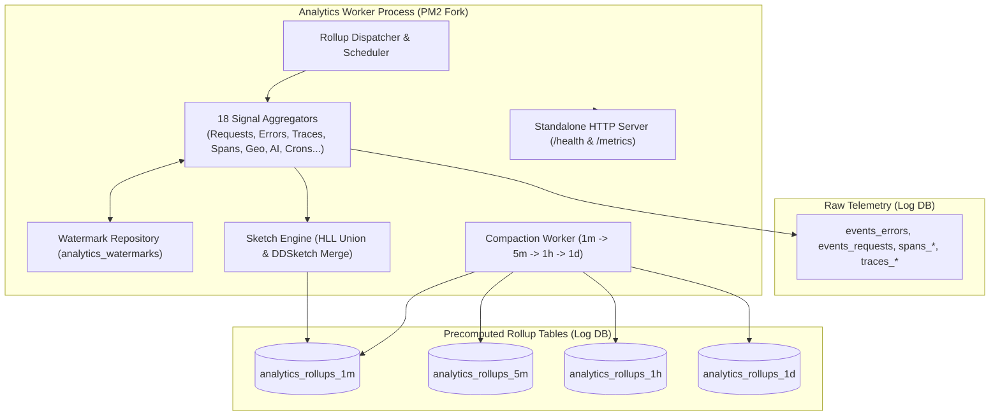

# Analytics Worker Tier Architecture

The **Analytics Worker Tier** is a specialized background process (`dist/shared/workers/analytics-worker-main.js`) that continuously computes and compacts time-series rollups (1m, 5m, 1h, 1d) across all ingested telemetry data in the Log DB.

---

## 1. Core Architectural Responsibilities

1. **Complete Ingestion Decoupling**: Imports nothing from `src/modules/ingestion` and runs on a dedicated Log DB pool, guaranteeing that heavy analytical rollups never block live ingestion traffic.
2. **Whole-Bucket Recomputing**: Idempotent recomputation over windowed buckets guarantees mathematical accuracy even when telemetry events arrive out-of-order.
3. **Continuous Watermark Progress**: Tracks progress via `analytics_watermarks` and alerts if watermark lag exceeds `ANALYTICS_FRESHNESS_STALE_SECONDS`.
4. **Standalone Metrics & Health Endpoint**: Exposes a native HTTP server (port 9092) with Prometheus metrics (`analytics_worker_watermark_lag_seconds`, `analytics_worker_runs_total`).

---

## 2. Key Components & Files

| Component | Location | Description |
| :--- | :--- | :--- |
| **`analytics-worker-main.ts`** | [`pulse/src/shared/workers/analytics-worker-main.ts`](file:///c:/Users/vikas/OneDrive/Desktop/SaasBackend/pulse/src/shared/workers/analytics-worker-main.ts) | Analytics worker process bootstrap, health server, and shutdown handler. |
| **`workers/requests.worker.ts`** | [`pulse/src/modules/analytics-engine/workers/requests.worker.ts`](file:///c:/Users/vikas/OneDrive/Desktop/SaasBackend/pulse/src/modules/analytics-engine/workers/requests.worker.ts) | Request count, status code, and latency distribution aggregator. |
| **`workers/errors.worker.ts`** | [`pulse/src/modules/analytics-engine/workers/errors.worker.ts`](file:///c:/Users/vikas/OneDrive/Desktop/SaasBackend/pulse/src/modules/analytics-engine/workers/errors.worker.ts) | Error grouping and affected user aggregator. |
| **`workers/compaction.worker.ts`** | [`pulse/src/modules/analytics-engine/workers/compaction.worker.ts`](file:///c:/Users/vikas/OneDrive/Desktop/SaasBackend/pulse/src/modules/analytics-engine/workers/compaction.worker.ts) | Multi-tier rollup compaction and hierarchy promotion engine. |
