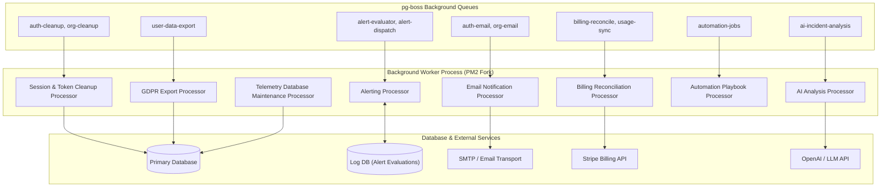

# Background Worker Tier Architecture

The **Background Worker Tier** is a multi-queue worker process (`dist/shared/workers/main.js`) handling transactional jobs, asynchronous business operations, system maintenance, and external integrations across the Pulsiv platform.

---

## 1. Core Architectural Responsibilities

1. **Multi-Queue Dispatching**: Consumes diverse job queues safely using `SKIP LOCKED` concurrency guarantees.
2. **ADR-0006 Pool Ownership Assertions**: Verifies at process startup that alerting evaluators connect to the Log DB primary pool where telemetry is written.
3. **Telemetry Maintenance Sweep**: Periodically drops expired telemetry partitions, creates future table partitions, and vacuums high-turnover tables.
4. **Resilient Transactional Email Dispatch**: Delivers verification codes, magic links, invitation emails, and incident alerts with retry safety.

---

## 2. Key Components & Files

| Component | Location | Description |
| :--- | :--- | :--- |
| **`main.ts`** | [`pulse/src/shared/workers/main.ts`](file:///c:/Users/vikas/OneDrive/Desktop/SaasBackend/pulse/src/shared/workers/main.ts) | Master background worker bootstrap and signal handling. |
| **`alerting.processor.ts`** | [`pulse/src/shared/workers/alerting.processor.ts`](file:///c:/Users/vikas/OneDrive/Desktop/SaasBackend/pulse/src/shared/workers/alerting.processor.ts) | Alert rule evaluator and notification dispatcher. |
| **`analysis.processor.ts`** | [`pulse/src/shared/workers/analysis.processor.ts`](file:///c:/Users/vikas/OneDrive/Desktop/SaasBackend/pulse/src/shared/workers/analysis.processor.ts) | AI automated root cause analysis worker. |
| **`auth-email.processor.ts`** | [`pulse/src/shared/workers/auth-email.processor.ts`](file:///c:/Users/vikas/OneDrive/Desktop/SaasBackend/pulse/src/shared/workers/auth-email.processor.ts) | Transactional auth email sender. |
| **`telemetry-maintenance.processor.ts`** | [`pulse/src/shared/workers/telemetry-maintenance.processor.ts`](file:///c:/Users/vikas/OneDrive/Desktop/SaasBackend/pulse/src/shared/workers/telemetry-maintenance.processor.ts) | Database partition creation and cleanup engine. |
