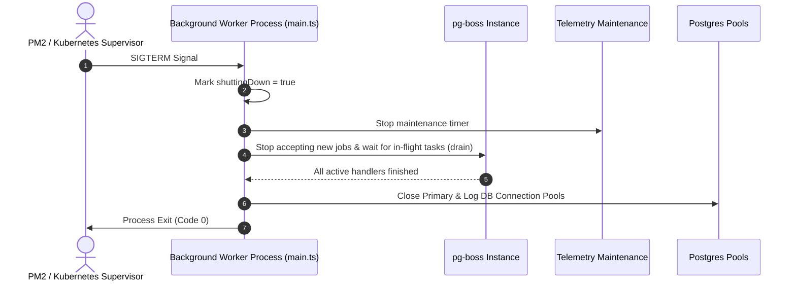

# Background Worker Tier Working & Operational Guide

This document describes the operational procedures, job processors, and shutdown lifecycles for the **Background Worker Tier**.

---

## 1. Process Lifecycle & Graceful Drain



---

## 2. Process Commands & Management

```bash
# Run background workers locally
npm run dev:workers

# Run in production
npm run start:workers

# Start via PM2
npx pm2 start ecosystem.config.cjs --only background-workers
```
