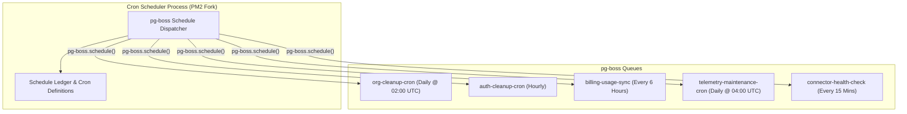

# Cron Scheduler Process Architecture

The **Cron Scheduler Process** (`dist/shared/workers/cron.js`) is the dedicated periodic schedule dispatcher that triggers recurring background jobs, subscription reconciliations, telemetry maintenance sweeps, and cleanup crons into pg-boss.

---

## 1. Core Architectural Responsibilities

1. **Centralized Job Scheduling**: Single source of truth for all periodic cron expressions (`cron.ts`).
2. **Distributed Leader Safety**: pg-boss manages internal distributed lock records so multiple running scheduler replicas do not dispatch duplicate jobs.
3. **Zero Business Logic in Scheduler**: The scheduler solely enqueues job payloads; actual computation occurs in worker tiers (`main.ts`, `ingestion-worker-main.ts`).
