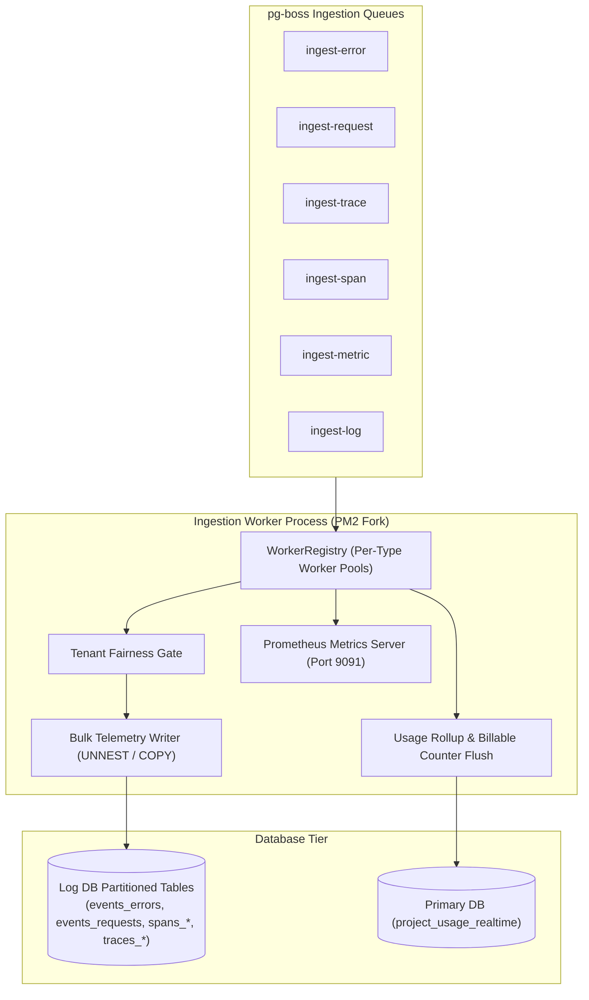

# Ingestion Worker Tier Architecture

The **Ingestion Worker Tier** is a dedicated background OS process (`dist/shared/workers/ingestion-worker-main.js`) designed to drain high-volume pg-boss telemetry queues and persist events into partitioned PostgreSQL Log DB tables at scale.

---

## 1. Core Architectural Responsibilities

1. **Dedicated Process Isolation**: Separated from both the Fastify API gateway and general background workers so heavy bulk writes never steal CPU from request intake.
2. **Bulk Vectorized INSERTs**: Uses PostgreSQL `UNNEST(ARRAY[...])` and multi-row parameterized batch inserts rather than row-by-row SQL statements.
3. **Tenant Fairness Gate**: Prevents a single high-volume tenant from monopolizing worker queue bandwidth through local token bucket consumption gates.
4. **Independent Scale**: Horizontally scalable across multiple PM2 instances or Kubernetes pods using PostgreSQL `SKIP LOCKED`.

---

## 2. Key Components & Files

| Component | Location | Description |
| :--- | :--- | :--- |
| **`ingestion-worker-main.ts`** | [`pulse/src/shared/workers/ingestion-worker-main.ts`](file:///c:/Users/vikas/OneDrive/Desktop/SaasBackend/pulse/src/shared/workers/ingestion-worker-main.ts) | Bootstrap script, pool lifecycle, and graceful shutdown handlers. |
| **`worker-registry.ts`** | [`pulse/src/modules/ingestion/workers/worker-registry.ts`](file:///c:/Users/vikas/OneDrive/Desktop/SaasBackend/pulse/src/modules/ingestion/workers/worker-registry.ts) | Registers queue consumers, DLQ intake, and usage cron. |
| **`event-processor.ts`** | [`pulse/src/modules/ingestion/workers/event-processor.ts`](file:///c:/Users/vikas/OneDrive/Desktop/SaasBackend/pulse/src/modules/ingestion/workers/event-processor.ts) | Batch consumer processing raw event jobs. |
| **`usage-rollup.ts`** | [`pulse/src/modules/ingestion/workers/usage-rollup.ts`](file:///c:/Users/vikas/OneDrive/Desktop/SaasBackend/pulse/src/modules/ingestion/workers/usage-rollup.ts) | Flushes staged project usage counters to PostgreSQL. |
| **`metrics-server.ts`** | [`pulse/src/modules/ingestion/workers/metrics-server.ts`](file:///c:/Users/vikas/OneDrive/Desktop/SaasBackend/pulse/src/modules/ingestion/workers/metrics-server.ts) | Exposes Prometheus metrics and queue depth gauges. |
