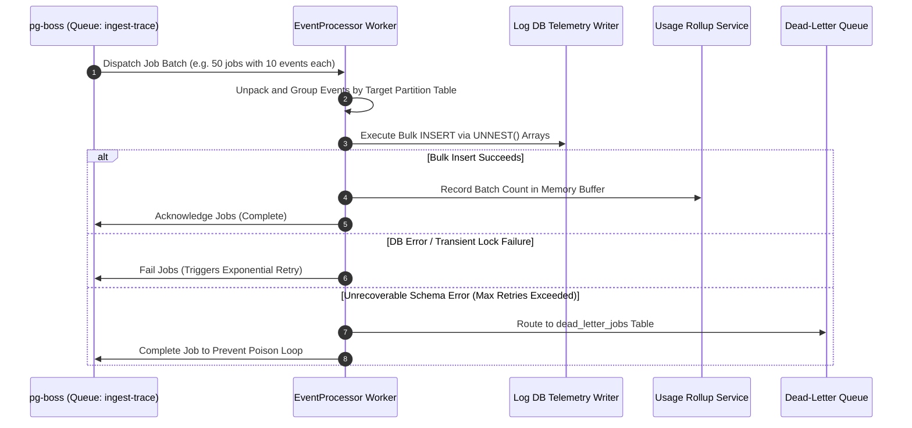

# Ingestion Worker Tier Working & Operational Guide

This document describes batch consumer execution, bulk write queries, failure retries, and dead-letter queue (DLQ) mechanics for the **Ingestion Worker Tier**.

---

## 1. Batch Persistence Execution Flow



---

## 2. Process Commands & Management

```bash
# Run Ingestion Worker locally
npm run dev:ingestion

# Run Ingestion Worker in production
npm run start:ingestion

# PM2 cluster management
npx pm2 start ecosystem.config.cjs --only ingestion-workers
```
